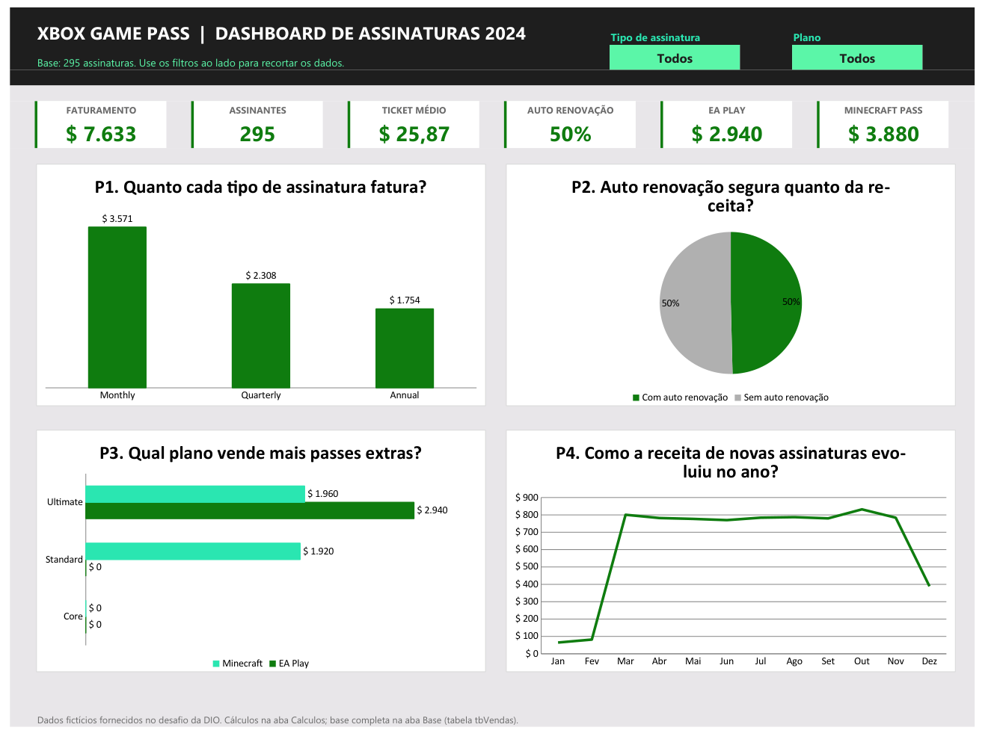
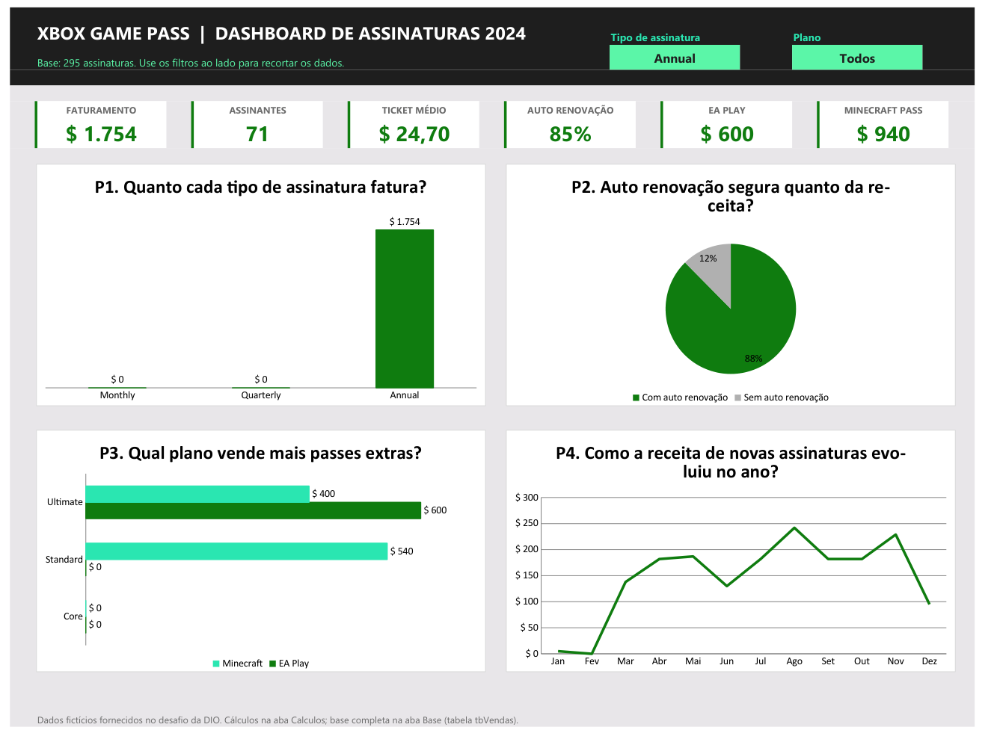

# Dashboard de vendas Xbox Game Pass no Excel

Dashboard em Excel que transforma uma base de 295 assinaturas do Xbox Game Pass (2024) em indicadores e gráficos que respondem perguntas de negócio. Tem filtros por tipo de assinatura e por plano, e tudo é recalculado na hora.

Projeto do Desafio de Projeto da DIO de dashboard de vendas no Excel (trilha Santander Excel 2026).

Arquivo: [`dashboard-xbox.xlsx`](dashboard-xbox.xlsx)

## Prints

**Sem filtro (todas as assinaturas)**



**Filtro aplicado: tipo de assinatura = Annual**



Com o filtro em Annual, o faturamento cai para $ 1.754, 71 assinantes, e a auto renovação sobe para 85% dos assinantes (88% da receita): quem assina o plano anual tende a deixar a renovação ligada.

## Os dados

Base fornecida no desafio (`base.xlsx`), dados fictícios, aba **Base** da planilha, formatada como a Tabela `tbVendas`:

| Coluna | Descrição |
|---|---|
| Subscriber ID, Name | Identificação do assinante |
| Plan | Core, Standard ou Ultimate |
| Start Date | Data de início (jan a dez/2024) |
| Auto Renewal | Yes / No |
| Subscription Price | Preço do plano |
| Subscription Type | Monthly, Quarterly ou Annual |
| EA Play Season Pass (+ Price) | Se comprou o passe e o valor |
| Minecraft Season Pass (+ Price) | Se comprou o passe e o valor |
| Coupon Value | Desconto de cupom |
| Total Value | Valor final (plano + passes − cupom) |

Tratamento feito: a coluna `EA Play Season Pass Price` vinha com `-` (texto) para quem não comprou o passe; troquei por `0` para a coluna ficar numérica e poder ser somada. A quebra de linha no nome dessa coluna também saiu.

## Perguntas de negócio

| # | Pergunta | Visual | Resposta (sem filtro) |
|---|---|---|---|
| P1 | Quanto cada tipo de assinatura fatura? | Colunas | Monthly $ 3.571, Quarterly $ 2.308, Annual $ 1.754 |
| P2 | A auto renovação segura quanto da receita? | Pizza | 50% com auto renovação ($ 3.786) e 50% sem ($ 3.847) |
| P3 | Qual plano vende mais passes extras (EA Play e Minecraft)? | Barras agrupadas | EA Play só no Ultimate ($ 2.940); Minecraft dividido entre Standard ($ 1.920) e Ultimate ($ 1.960) |
| P4 | Como a receita de novas assinaturas evoluiu no ano? | Linha | Jan/fev fracos, estável perto de $ 780/mês de março a novembro, queda em dezembro (meio mês de dados) |

Indicadores de topo: faturamento total, assinantes, ticket médio, % com auto renovação, receita de EA Play e de Minecraft Season Pass.

As perguntas 1 a 4 seguem as do Expert (faturamento por tipo, auto renovação, EA Play e Minecraft). Conferi os números com as tabelas dinâmicas do gabarito: com o filtro em Monthly, auto renovação dá $ 747 (Yes) e $ 2.824 (No), EA Play $ 1.350 e Minecraft $ 1.800, iguais ao arquivo finalizado.

## Como foi construído

### Aba Calculos
Em vez de tabelas dinâmicas, cada pergunta tem uma tabela pequena calculada com `SOMASES` / `CONT.SES` sobre a tabela `tbVendas`. Exemplo da P1:

```
=SOMASES(tbVendas[Total Value]; tbVendas[Subscription Type]; B15;
         tbVendas[Subscription Type]; crit_tipo; tbVendas[Plan]; crit_plano)
```

E da P4, somando por mês com intervalo de datas:

```
=SOMASES(tbVendas[Total Value];
         tbVendas[Start Date]; ">="&DATA(2024;3;1);
         tbVendas[Start Date]; "<="&FIMMÊS(DATA(2024;3;1);0);
         tbVendas[Subscription Type]; crit_tipo; tbVendas[Plan]; crit_plano)
```

### Filtros
No topo do Dashboard há duas listas suspensas (validação de dados): **Tipo de assinatura** e **Plano**, com a opção "Todos". Na aba Calculos, cada filtro vira um critério:

```
crit_tipo   =SE(filtro_tipo="Todos"; "*"; filtro_tipo)
crit_plano  =SE(filtro_plano="Todos"; "*"; filtro_plano)
```

O `*` é curinga: com "Todos", o `SOMASES` aceita qualquer valor. Todas as fórmulas usam esses dois critérios, então os cartões e os quatro gráficos mudam juntos.

### Intervalos nomeados
`filtro_tipo`, `filtro_plano`, `crit_tipo`, `crit_plano`, `kpi_fat`, `kpi_qtd`, `kpi_ticket`, `kpi_auto`, `kpi_cupom`, `kpi_ea`, `kpi_mine`.

### Visual
- Paleta da aba Assets do desafio: verde Xbox (`#107C10` / `#9BC848`), menta (`#2AE6B1`, `#5BF6A8`) nos destaques e cinza `#E8E6E9` ("negative zone") no fundo.
- Cabeçalho escuro, cartões brancos com borda verde, linhas de grade e títulos de linha/coluna ocultos.
- Cada gráfico tem como título a própria pergunta de negócio.

## O que mudei em relação ao gabarito

- **Filtros com lista suspensa + `SOMASES`** no lugar da segmentação de dados com tabela dinâmica. O resultado é o mesmo, mas os filtros controlam todos os visuais de uma vez e não precisa "Atualizar tudo" quando a base muda.
- **Dois filtros** (tipo de assinatura e plano) em vez de um.
- **Pergunta nova (P4)**: evolução mensal da receita.
- **Cartões de KPI** com ticket médio e % de auto renovação.

## Como reproduzir

1. Abra `dashboard-xbox.xlsx` na aba **Dashboard**.
2. Troque **Tipo de assinatura** ou **Plano** nas caixas verdes do topo.
3. Para usar outra base, cole os dados novos na tabela `tbVendas` (aba Base) mantendo os nomes das colunas; o dashboard se atualiza sozinho.
